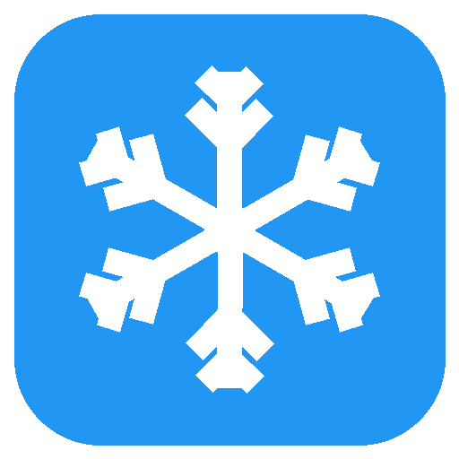

# Vriezer for Home Assistant

A custom integration that keeps track of what is in your freezer. Every package gets a unique code and a printed label. You can take a package out completely or in part (400 g of mince down to 200 g), and an optional QR code on the label lets you do that straight from your phone. It comes with a dashboard view: a form to add packages, a print queue, totals per product and the list of packages.

The integration, its actions and the dashboard are in Dutch (`vriezer` = freezer, `toevoegen` = add, `uithalen` = take out, `pakje` = package). An English translation of the settings, actions and fields is included. [Nederlandse uitleg staat onderaan.](#nederlands)

## Features

- **Categories** that you set up yourself (e.g. Meat `V`, Leftovers `R`, Fish `F`): name, 1 to 3 code letters, how many days it keeps in the freezer, QR code on or off.
- **A code per package**: code letters plus a 4-digit hex counter, e.g. `V-0015`. Several packages at once each get their own code.
- **Add first, print later**: new packages go to a print queue. Print one label, or all labels in the queue at once. A label can be printed again at any time.
- **Take out all or part**: amounts are understood in g, kg, ons, ml, l and pieces (`st`, `stuks`, `porties`); kg and g are converted. Enter how much you take out, or what is left. *Put back* undoes a mistake.
- **Totals per product** per category, with the oldest package first and the "use before" date (freeze date plus the days of the category). Packages past that date are shown in red.
- **QR code on the label** (optional): it is a Home Assistant tag. Scanning it with a phone that runs the Companion app either opens the dashboard with that package selected (Android), or sends a notification to that phone with *Take all*, *Take part* (type the amount as a reply, Android) and *Open*, or both. Ignoring the notification changes nothing.
- **Any label printer**: the integration draws each label as a black and white PNG at the size you set, and passes the file path to an action of your choice. Without an action it only fires the event `vriezer_label`, so you can print with your own automation.
- **Receipt printer** (optional): prints an overview of the freezer as plain text through an action of your choice (e.g. an ESC/POS integration), or fires the event `vriezer_bon`.
- **Shopping list endpoint**: `vriezer.van_boodschappenlijst` moves a line from a to-do list (e.g. "Mince - 500 g" on the butcher list) to the freezer and ticks it off there.
- **Import** from to-do lists in the format "Name - amount" with description "V-0001 | ingevroren dd/mm/yyyy".
- Data is stored locally in `.storage/vriezer`. Removed packages are kept for a year (for undo and reprints). The lists are kept out of the recorder database.

## Installation

### HACS (custom repository)

1. HACS > three dots > *Custom repositories* > add `https://github.com/ffrericks/ha-vriezer` with type *Integration*.
2. Install *Vriezer* and restart Home Assistant.

### Manual

Copy `custom_components/vriezer` to `config/custom_components/vriezer` and restart Home Assistant.

### Set up

*Settings > Devices & services > Add integration > Vriezer*. It starts with two categories (Vlees `V`, 90 days and Restjes `R`, 60 days). Change everything under *Configure*:

| Menu | Settings |
| --- | --- |
| General | QR codes on labels, phone for notifications (default: the phone that scans), dashboard path for the *Open* button, what happens on a scan (notification, open the page, or both) |
| Add / edit / delete category | name, code letters (cannot change later), days, QR on the label. A category can only be deleted when it is empty. |
| Label printer | action, name of its field for the file path, extra data (JSON), label width and height in printer dots, margins, pause between labels |
| Receipt printer | action, name of its field for the text, characters per line, extra data (JSON) |

#### Label printer

The label is landscape: optional QR code on the left, then the code, the name and the freeze date. Set the size in printer dots, e.g. 240 x 96 for a 30 x 14 mm label on a 203 dpi printer. The action gets the path of the PNG in the field you name, plus the extra data. For example, an action `my_printer.print_image` with a field `file` and extra data `{"copies": 1}`. The file is stored under `/config/vriezer_labels/`.

Some small Bluetooth printers get confused when labels follow each other quickly; the *pause between labels* (default 5 s) helps. Set it to 0 if your printer does not need it.

No action? Use the event in an automation:

```yaml
triggers:
  - trigger: event
    event_type: vriezer_label
actions:
  - action: my_printer.print_image
    data:
      file: "{{ trigger.event.data.bestand }}"
```

The event data has `code`, `naam` (name), `hoeveelheid` (amount), `ingevroren` (frozen on), `op_voor` (use before), `bestand` (file) and `qr`.

#### QR codes

The QR code holds `https://www.home-assistant.io/tag/vz<code>`. The Companion app opens that link and reports the scan to Home Assistant, so no extra app is needed. The first scan of each label adds it to *Settings > Tags*. Test a printed code before you label the whole freezer: very small or cheap printers may not print it sharp enough.

### Dashboard

1. Install [button-card](https://github.com/custom-cards/button-card) (HACS).
2. Open a dashboard > three dots > *Edit dashboard* > three dots > *Raw configuration editor* and paste the view from [`dashboard/vriezer-view.yaml`](dashboard/vriezer-view.yaml) under `views:`.
3. Set *General > dashboard path* to the path of that view (default `/lovelace/vriezer`).

The view has a form (category, number of packages, name, amount per package, freeze date), the print queue, totals per product and every package. Tap a package for *Take all*, *Take out* / *Left over*, *Print label*, *Edit* and *Undo* for recently removed packages.

## Actions

All actions except `lijst` return `{ok: true, ...}` or `{ok: false, fout: "..."}` when a response is requested, otherwise they raise an error. Error messages are in Dutch.

| Action | Fields | Response |
| --- | --- | --- |
| `vriezer.toevoegen` | `naam`, optional `categorie` (name or letters, default the first), `hoeveelheid` (e.g. `400 g`), or `regel` (`"Mince - 400 g"`) instead of name and amount, `pakjes` (number), `ingevroren`, `op_voor`, `opmerking`, `printen` (print now instead of queueing) | `{codes}` |
| `vriezer.van_boodschappenlijst` | `entity_id` (todo list), `uid` of the line, optional `categorie`, `pakjes`, `printen` | `{codes, naam}` |
| `vriezer.uithalen` | `code` (`v0015` works too), optional `hoeveelheid` (taken out) or `rest` (left); none = everything | `{code, over, op}` |
| `vriezer.terugzetten` | `code` | `{code}` |
| `vriezer.wijzigen` | `code`, optional `naam`, `hoeveelheid`, `ingevroren`, `op_voor`, `opmerking` | `{code}` |
| `vriezer.verwijderen` | `code` (deletes without history, for mistakes) | |
| `vriezer.labels_printen` | optional `codes` (empty = the queue) | `{geprint, fout}` |
| `vriezer.uit_wachtrij` | optional `codes` (mark as printed without printing) | `{codes}` |
| `vriezer.bon_printen` | optional `categorie` | `{tekst}` |
| `vriezer.importeren` | `lijsten`: `[{entity_id, categorie}]` | `{overgenomen, overgeslagen, teller}` |
| `vriezer.lijst` | - | everything the sensor has |

### Entity

`sensor.vriezer_voorraad`: the number of packages in the freezer. Attributes: `pakjes` (packages), `recent_uit` (last 20 removed), `categorieen`, `te_printen` (labels in the queue), `qr`, `labelprinter`, `bonprinter`. The large attributes are not recorded.

### Example: butcher list button

```yaml
action: vriezer.van_boodschappenlijst
data:
  entity_id: todo.butcher
  uid: "{{ uid }}"
  categorie: Vlees
```

## Note

Notifications to Android phones go through Google's push service (Firebase), so the name and amount of a scanned package pass through that service.

## Nederlands

Een eigen integratie voor Home Assistant die bijhoudt wat er in de vriezer ligt. Elk pakje krijgt een eigen code en een label.

- **Categorieën** stel je zelf in: naam, codeletter(s), hoe lang het houdbaar is, QR-code aan of uit.
- **Eerst toevoegen, dan printen**: nieuwe pakjes komen in een wachtrij; print ze los of allemaal tegelijk, en opnieuw wanneer je wilt.
- **Helemaal of deels uithalen**: bijvoorbeeld 400 g gehakt terug naar 200 g. Vul in hoeveel je eruit haalt of wat er overblijft. *Terugzetten* maakt een vergissing ongedaan.
- **QR-code op het label** (optioneel): scan hem met de telefoon met de HA-app en de pagina met het pakje gaat open (Android), of je krijgt een melding met *Helemaal eruit*, *Deel eruit* en *Openen*, of allebei. Een melding negeren verandert niets.
- **Elke labelprinter**: de integratie tekent het label als PNG en geeft het pad aan een actie die jij kiest; zonder actie komt de gebeurtenis `vriezer_label`. Stel de labelmaat in printerpunten in, en eventueel een pauze tussen labels.
- **Bonprinter** (optioneel): een overzicht van de vriezer op een bonnetje.
- **Boodschappenlijst**: `vriezer.van_boodschappenlijst` zet een regel van bijvoorbeeld de slagerlijst in de vriezer en vinkt hem daar af.

Installeren: via HACS als custom repository of door `custom_components/vriezer` naar je HA-config te kopiëren, HA herstarten en de integratie *Vriezer* toevoegen. Instellen via *Configureren*. Voor het tabblad heb je button-card nodig; plak `dashboard/vriezer-view.yaml` onder `views:` in de ruwe configuratie van een dashboard.

## License

MIT. The bundled font `Roboto.ttf` is licensed under the SIL Open Font License 1.1, see [`Roboto-OFL.txt`](custom_components/vriezer/Roboto-OFL.txt).
