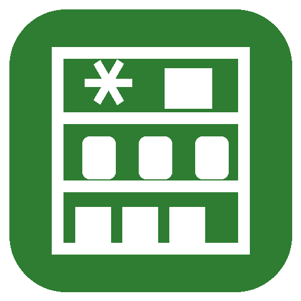

# Voorraadbeheer for Home Assistant

A custom integration that keeps track of your food stock per location: freezer, fridge, cellar, pantry or any location you add. Every item gets a unique code and, if you want, a printed label. You can take an item out completely or in part (400 g of mince down to 200 g), and an optional QR code on the label opens the item straight from your phone. It comes with a dashboard view: a form to add items, a print queue, search, and a block per location with totals per product.

The integration, its actions and the dashboard are in Dutch (`voorraad` = stock, `toevoegen` = add, `uithalen` = take out, `locatie` = location, `houdbaar tot` = best before). An English translation of the settings, actions and fields is included. [Nederlandse uitleg staat onderaan.](#nederlands)

This integration was called *Vriezer* (freezer) before; on first setup it takes over the stock and settings of that version.

## Features

- **Locations** you set up yourself (Freezer, Fridge, Cellar are there to start with). A location is either a freezer or not:
  - **in a freezer** the date is the freeze date plus the number of days the category keeps;
  - **elsewhere** every item needs a best-before date.
- **Categories** you set up yourself: name, 1 to 3 code letters, location, days it keeps in the freezer, whether it needs a printed label, and QR code on or off.
- **Products are remembered**: enter a product (e.g. *Minced beef*) and an optional description (e.g. *from the butcher*). Next time the product is suggested and its category is picked for you. Totals are per product, whatever the description.
- **A code per item**: code letters plus a 4-digit hex counter, e.g. `V-0015`.
- **Add first, print later**: items of a category with labels go to a print queue. Print one label or all at once, and again at any time. Categories without labels skip the queue.
- **Take out all or part**: amounts in g, kg, ons, ml, l and pieces (`st`, `stuks`, `pak`, `blik`, `pot`, `fles`, `porties`); kg and g are converted. Enter how much you take out, or what is left. *Put back* undoes a mistake.
- **Search** on product, description or code across all locations.
- **QR code on the label** (optional): a Home Assistant tag. Scanning it with a phone that runs the Companion app opens the dashboard with that item (Android), or sends a notification with *Take all*, *Take part* (type the amount as a reply) and *Open*, or both. Ignoring the notification changes nothing.
- **Any label printer**: each label is drawn as a black and white PNG at the size you set and passed to an action of your choice. Without an action it only fires the event `voorraad_label`, so you can print with your own automation.
- **Receipt printer** (optional): an overview of the stock as plain text through an action of your choice (e.g. an ESC/POS integration), or the event `voorraad_bon`.
- **Shopping list endpoint**: `voorraad.van_boodschappenlijst` moves a line from a to-do list (e.g. "Mince - 500 g" on the butcher list) into stock and ticks it off there.
- Data is stored locally in `.storage/voorraad`. Removed items are kept for a year (for undo and reprints). The lists are kept out of the recorder database.

## Installation

### HACS (custom repository)

1. HACS > three dots > *Custom repositories* > add `https://github.com/ffrericks/ha-voorraad` with type *Integration*.
2. Install *Voorraadbeheer* and restart Home Assistant.

### Manual

Copy `custom_components/voorraad` to `config/custom_components/voorraad` and restart Home Assistant.

### Set up

*Settings > Devices & services > Add integration > Voorraadbeheer*. It starts with the locations Vriezer (freezer), Koelkast (fridge) and Kelder (cellar) and two freezer categories (Vlees `V`, 90 days and Restjes `R`, 60 days). Change everything under *Configure*:

| Menu | Settings |
| --- | --- |
| General | QR codes on labels, phone for notifications (default: the phone that scans), dashboard path, what happens on a scan (notification, open the page, or both) |
| Add / edit / delete location | name, *this is a freezer*. A location can only be deleted when no category uses it. |
| Add / edit / delete category | name, code letters (cannot change later), location, days in the freezer, print a label, QR on the label. A category can only be deleted when nothing of it is in stock. |
| Label printer | action, name of its field for the file path, extra data (JSON), label width and height in printer dots, margins, pause between labels |
| Receipt printer | action, name of its field for the text, characters per line, extra data (JSON) |

#### Label printer

The label is landscape: optional QR code on the left, then the code, the product with its description, and the freeze date (freezer) or `THT` best-before date (elsewhere). Set the size in printer dots, e.g. 240 x 96 for a 30 x 14 mm label on a 203 dpi printer. The action gets the path of the PNG in the field you name, plus the extra data. The file is stored under `/config/voorraad_labels/`.

Some small Bluetooth printers get confused when labels follow each other quickly; the *pause between labels* (default 5 s) helps. Set it to 0 if your printer does not need it.

No action? Use the event in an automation:

```yaml
triggers:
  - trigger: event
    event_type: voorraad_label
actions:
  - action: my_printer.print_image
    data:
      file: "{{ trigger.event.data.bestand }}"
```

The event data has `code`, `product`, `omschrijving` (description), `hoeveelheid` (amount), `ingevroren` (frozen on), `houdbaar_tot` (best before), `locatie`, `bestand` (file) and `qr`.

#### QR codes

The QR code holds `https://www.home-assistant.io/tag/vz<code>`. The Companion app opens that link and reports the scan to Home Assistant, so no extra app is needed. The first scan of each label adds it to *Settings > Tags*. Opening the page directly uses the Android notification command `command_webview`; iPhones always get the notification. Test a printed code before you label everything: very small or cheap printers may not print it sharp enough.

### Dashboard

1. Install [button-card](https://github.com/custom-cards/button-card) (HACS).
2. Open a dashboard > three dots > *Edit dashboard* > three dots > *Raw configuration editor* and paste the view from [`dashboard/voorraad-view.yaml`](dashboard/voorraad-view.yaml) under `views:`.
3. Set *General > dashboard path* to the path of that view (default `/lovelace/voorraad`).

The view has the form (category, number, product with suggestions, description, amount per item, freeze date or best-before date), the print queue, search and a block per location. Tap an item for *Take all*, *Take out* / *Left over*, *Print label*, *Edit* and *Collapse*; recently removed items can be put back.

## Actions

All actions except `lijst` return `{ok: true, ...}` or `{ok: false, fout: "..."}` when a response is requested, otherwise they raise an error. Error messages are in Dutch.

| Action | Fields | Response |
| --- | --- | --- |
| `voorraad.toevoegen` | `product`, optional `categorie` (name or letters, default the first), `omschrijving`, `hoeveelheid` (e.g. `400 g`), or `regel` (`"Mince - 400 g"`) instead of product and amount, `pakjes` (number), `ingevroren` (freezer), `houdbaar_tot` (required outside a freezer), `printen` (print now instead of queueing) | `{codes}` |
| `voorraad.van_boodschappenlijst` | `entity_id` (todo list), `uid` of the line, optional `categorie`, `omschrijving`, `pakjes`, `houdbaar_tot`, `printen` | `{codes, product}` |
| `voorraad.uithalen` | `code` (`v0015` works too), optional `hoeveelheid` (taken out) or `rest` (left); none = everything | `{code, over, op}` |
| `voorraad.terugzetten` | `code` | `{code}` |
| `voorraad.wijzigen` | `code`, optional `product`, `omschrijving`, `hoeveelheid`, `categorie` (moves it), `ingevroren`, `houdbaar_tot` | `{code}` |
| `voorraad.verwijderen` | `code` (deletes without history, for mistakes) | |
| `voorraad.labels_printen` | optional `codes` (empty = the queue) | `{geprint, fout}` |
| `voorraad.uit_wachtrij` | optional `codes` (mark as printed without printing) | `{codes}` |
| `voorraad.bon_printen` | optional `locatie` | `{tekst}` |
| `voorraad.product_vergeten` | `product` (remove it from the suggestions) | |
| `voorraad.importeren` | `lijsten`: `[{entity_id, categorie}]` | `{overgenomen, overgeslagen, teller}` |
| `voorraad.lijst` | - | everything the sensor has |

### Entity

`sensor.voorraad`: the number of items in stock. Attributes: `pakjes` (items), `recent_uit` (last 20 removed), `locaties`, `categorieen`, `producten`, `te_printen` (labels in the queue), `qr`, `labelprinter`, `bonprinter`. These attributes are not recorded.

### Example: butcher list button

```yaml
action: voorraad.van_boodschappenlijst
data:
  entity_id: todo.slager
  uid: "{{ uid }}"
  categorie: Vlees
```

## Note

Notifications to Android phones go through Google's push service (Firebase), so the product name and amount of a scanned item pass through that service.

## Nederlands

Een eigen integratie voor Home Assistant die de voorraad per locatie bijhoudt: vriezer, koelkast, kelder, voorraadkast of een eigen locatie. Elk stuk krijgt een code en, als je wilt, een label.

- **Locaties** stel je zelf in. In een vriezer telt de invriesdatum plus de houdbare dagen van de categorie; elders vul je de houdbaarheidsdatum (THT) in, die is dan verplicht.
- **Categorieën**: naam, codeletter(s), locatie, dagen in de vriezer, label ja of nee, QR-code ja of nee.
- **Producten worden onthouden**: vul een product in (bv. *Rundergehakt*) en eventueel een omschrijving (bv. *van de slager*). De volgende keer wordt het product voorgesteld en de categorie erbij gekozen. Totalen gaan per product, ongeacht de omschrijving.
- **Eerst toevoegen, dan printen**: stuks met een label komen in een wachtrij. Categorieën zonder label slaan die over.
- **Helemaal of deels uithalen**: vul in hoeveel je eruit haalt of wat er overblijft. *Terugzetten* maakt een vergissing ongedaan.
- **Zoeken** op product, omschrijving of code, en per locatie een blok.
- **QR-code op het label** (optioneel): scan hem met de telefoon met de HA-app en de pagina met het stuk gaat open (Android), of je krijgt een melding met knoppen, of allebei.
- **Elke labelprinter** via een actie die een plaatje print, of de gebeurtenis `voorraad_label`; optioneel een **bonprinter** voor een overzicht.
- **Boodschappenlijst**: `voorraad.van_boodschappenlijst` zet een regel van bv. de slagerlijst in de voorraad en vinkt hem daar af.

Installeren: via HACS als custom repository of door `custom_components/voorraad` naar je HA-config te kopiëren, HA herstarten en de integratie *Voorraadbeheer* toevoegen. Instellen via *Configureren*. Voor het tabblad heb je button-card nodig; plak `dashboard/voorraad-view.yaml` onder `views:` in de ruwe configuratie van een dashboard.

## License

MIT. The bundled font `Roboto.ttf` is licensed under the SIL Open Font License 1.1, see [`Roboto-OFL.txt`](custom_components/voorraad/Roboto-OFL.txt).
